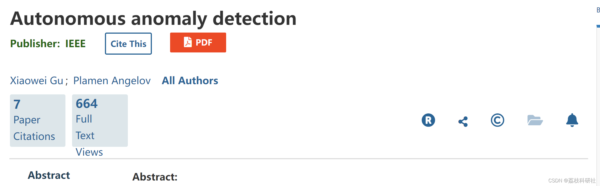
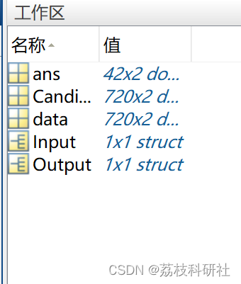

# Self-Observation Algorithm for Abnormality Detection (Matlab Code Implementation)

​  
Editor
This paper introduces a new method for autonomous anomaly detection within the framework of empirical data analysis (EDA). This method is entirely data-driven and does not require thresholds. It employs a non-parametric EDA estimator, which can objectively and autonomously detect anomalies based on the mutual distribution and integrated characteristics of the data. The method first identifies potential anomalies according to two EDA standards, then categorizes them into shapeless non-parametric data clouds. Finally, it identifies anomalies associated with each data cloud (locally). Numerical examples based on both comprehensive datasets and benchmark datasets validate the effectiveness and efficiency of the proposed method.
📚2 Running Results Editing
Part of the code:
%% Output  
%%  Output.IDX      - The indices of the identified anomalies  
%%  Output.SystemParams - The identified anomalies  
data=Input.Data;  
Lorigin=size(data,1);  
Aver=mean(data,1);  
X=mean(sum(data.^2,2));  
dist1=pdist(data,'euclidean');  
Averdist=mean(dist1(find(dist1<=mean(dist1(find(dist1<=mean(dist1)))))));  
[UD,J,K]=unique(data,'rows');  
F = histc(K,1:numel(J));  
[L,W]=size(UD);  
GlobalDensity=F./(ones(L,1)+sum((UD-repmat(Aver,L,1)).^2,2)./((X-sum(Aver.^2))));  
GlobalDensity=GlobalDensity(K,:);  
dist=pdist2(UD,data);  
LocalDensity=zeros(L,1);  
LPotenAbnorm=round(Lorigin/18);  
for i=1:1:L  
s0=find(dist(i,:)<Averdist);  
if length(s0)>1  
data0=data(s0,:);  
Ave0=mean(data0,1);  
DELTA=mean(sum(data0.^2,2))-sum(Ave0.^2);  
LocalDensity(i)=F(i)/(1+sum((UD(i,:)-Ave0).^2)/DELTA)*(length(s0)-1)/(L);  
else  
LocalDensity(i)=0;  
end  
end  
LocalDensity=LocalDensity(K,:);  
[~,IDX1] = sort(LocalDensity,'ascend');  
[~,IDX2] = sort(GlobalDensity,'ascend');  
IDPA=unique([IDX1(1:1:LPotenAbnorm);IDX2(1:1:LPotenAbnorm)]);  
dataPA=data(IDPA,:);  
[~,~,IDX,Mnumber,~]=FormingDataCloud(dataPA);  
if isempty(Mnumber(Mnumber~=1))~=1  
AMN=mean(Mnumber(Mnumber~=1));  
else  
AMN=2;  
end  
seq=find(Mnumber<=AMN);  
AbnoID=[];  
for i=1:1:length(seq)  
seq0=find(IDX==seq(i));  
AbnoID=[AbnoID;seq0];  
end  
AbnoIDX=sort(IDPA(AbnoID),'ascend');  
AbnoData=data(AbnoIDX,:);  
Output.IDX=AbnoIDX;  
Output.Anomaly=AbnoData;  
end  
function [NoC,center,IDX,Mnumber,LocalX]=FormingDataCloud(data)  
%%  
[L,W]=size(data);  
%%  
[UD,J,K]=unique(data,'rows');  
F = histc(K,1:numel(J));  
LU=length(UD(:,1));  
%%  
dist=pdist(UD,'euclidean');  
dist=squareform(dist).^2;  
unidata_pi=sum(dist.*repmat(F',LU,1),2);  
unidata_density=unidata_pi'*F./(unidata_pi.*2*L);  
unidata_glodensity=unidata_density.*F;  
[~,pos]=max(unidata_glodensity);  
seq=1:1:LU;  
seq=seq(seq~=pos);  
Rank=zeros(LU,1);  
Rank(1,:)=pos;  
for i=2:1:LU  
[~,pos0]=min(dist(pos,seq));  
pos=seq(pos0);  
Rank(i,:)=pos;  
seq=seq(seq~=pos);  
end  
UD1=UD(Rank,:);  
UGDen=unidata_glodensity(Rank);  
F1=F(Rank);  
Gradient=zeros(2,LU-2);  
Gradient(1,:)=UGDen(1:1:LU-2)-UGDen(2:1:LU-1);  
Gradient(2,:)=UGDen(2:1:LU-1)-UGDen(3:1:LU);  
seq2=2:1:LU-1;  
seq1=find(Gradient(1,:)<0&Gradient(2,:)>0);  
if Gradient(2,LU-2)<0  
seq3=[1,seq2(seq1),LU];  
else  
seq3=[1,seq2(seq1)];  
end  
%%  
LU2=length(seq3);  
UD2=UD1(seq3,:);  
dist1=pdist2(UD2,data);  
[~,seq4]=min(dist1,[],1);  
centre=zeros(LU2,W);  
Mnumber=zeros(LU2,1);  
for i=1:1:LU2  
seq5=find(seq4==i);  
Mnumber(i)=length(seq5);  
centre(i,:)=mean(data(seq5,:));  
end  
seq0=find(Mnumber==1);  
M0=length(seq0);  
LU2=LU2-M0;  
C0=centre(seq0,:);  
seq0=find(Mnumber>1);  
centre=centre(seq0,:);  
🌈3 Matlab code + data
🎉4 References
[2] X. Gu, "Self-organising Transparent Learning System," Phd Thesis, Lancaster University, 2018.  
​  

## Images

<!-- PAYMENT_BLOCK -->

## Get this dataset

- Payment link (Stripe): [Buy now](https://buy.stripe.com/3cs8yP7sY87d0vu9AB)
- Payment QR code: 

<!-- /PAYMENT_BLOCK -->
